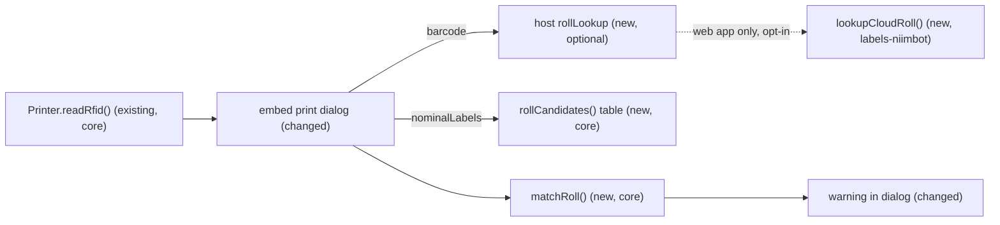

# Roll size detection and a label-size mismatch warning

> Status: approved design. On 2026-10-20 the maintainer chose to build Phase 1 now and defer the NIIMBOT cloud lookup (A4): the offline table already tells the rolls in use apart (50 × 30 with 230 labels, 50 × 80 with 95). Phases 2–3 stay described and start only when an ambiguous count or an unknown roll makes them worth the risk. Refs #7, #14, #19.

## 📝 TLDR
Today a 50 × 30 template prints on a 50 × 80 roll without a word: the label lands shifted or cut, and the user finds out from wasted labels. This spec is about future behavior. Before printing, the print dialog reads the loaded roll, works out its label size and shows a warning when the size does not match the template. The size comes from two sources. The first is an offline table that turns the roll's nominal label count into candidate sizes. The second is an optional lookup in the NIIMBOT cloud, which is what the official apps use. The web app enables the lookup only with the user's consent. No roll identifier is committed to the repository.

## 📝 Problem Statement
- **The printer does not report the size.** The B1's `GET_RFID` reply (firmware 5.26) carries a UID, an 8-digit `barcode`, a 16-character `serial`, the counters and `nominalLabels` (#52). It has no width or height. The tag does store the size, but TEA-encrypted behind a password ([community wiki](https://printers.niim.blue/other/rfig-tags/)). `GetPaperInfo` (`0x59`), which returns the size on protocol-4 printers, gets "unsupported" (`55 55 00 01 01 00`) from the B1 (#7).
- **No identifier on the chip is a roll-type key.** Several 8-digit `barcode` values belong to one size: three different codes are known for 50 × 30 rolls. The `serial` does not contain the type number printed in the core (30598, 30680). A committed catalogue keyed by `barcode` would need one entry per production batch.
- **The official apps ask the NIIMBOT cloud.** `POST https://print.niimbot.com/api/template/getCloudTemplateByOneCode` with `{"oneCode": <barcode>}` returns the roll record. Tested on 2026-10-20: no authentication is needed, and the CORS preflight answers `access-control-allow-origin: *` and allows the required `niimbot-user-agent` header. The 50 × 80 roll came back as `width 80, height 50, rotate 90`. The two other 50 × 30 codes came back as `50 × 30, rotate 0` and `30 × 50, rotate 270`. An unknown code returns `code != 1` and no data. The API is undocumented ([community wiki](https://printers.niim.blue/other/niimbot-cloud/)) and its terms of use are unclear.
- **The nominal count narrows the size down without any network.** The roll names collected in #7 give: 230 → 50 × 30 or 30 × 30; 320 → 40 × 20 or 50 × 20; 120 → 40 × 60; 95 → 50 × 80; 150 → 50 × 50 (round). In the most common mistake, a 50 × 30 template on a 50 × 80 roll (95), the table alone shows the mismatch.

## 📝 Proposed Solution
A size **source** produces candidate printed sizes for the loaded roll. A pure **matcher** compares them with the template's printed size and gives one verdict:

| Verdict | When | Dialog |
|---|---|---|
| `match` | a known roll size equals the template's printed size | nothing, or a quiet "Roll: 50 × 30 mm" line |
| `mismatch` | every known candidate differs | a warning above Print; printing stays possible |
| `ambiguous` | the candidates include the template size but also others (230, 320) | nothing |
| `unknown` | no tag (third-party roll), no reply, or a count missing from the table | nothing |

Sources, in order (the first one that answers wins):
1. **Host lookup (optional).** A `rollLookup(barcode)` callback the host passes to the dialog. The web app uses it to ask the NIIMBOT cloud and its own cache.
2. **Offline table.** `nominalLabels` → candidate sizes, committed, built from roll names only.

**Alternatives considered:**
- *A committed `barcode` catalogue.* Rejected: the codes change per batch, so the catalogue would always be stale, and every entry would be an identifier taken from someone's roll.
- *Decrypting the tag.* Rejected: it needs the tag password and key, means working around a vendor protection, and the printer does not forward the raw pages.
- *`GetPaperInfo`.* Not available on the B1. It stays an extension point for protocol-4 models (#19).
- *A blocking error on mismatch.* Rejected for v1: the offline table is a heuristic, and a deliberate print on another roll (a test, an unusual roll) must still work.

## 📝 Architecture

The network call is reachable only through the host callback. Embed itself still fetches and sends nothing.

- **`@spokospace/labels-core`, new `roll.ts` (pure, no I/O):**
  - `RollSize` = `{ widthMm, heightMm }`, the printed size: `widthMm` across the head, `heightMm` along the feed.
  - `rollCandidates(nominalLabels)` reads the offline table.
  - `matchRoll(templateSize, candidates)` returns the verdict and the candidate sizes.
  - Core is the right home: it already owns `RfidInfo` and the printer geometry, and has no dependency on render.
- **`@spokospace/labels-niimbot`, new `cloud.ts`:**
  - `lookupCloudRoll(barcode, { fetch, signal })` → `{ ok: true, size: RollSize, name?, paperType? } | { ok: false, reason }`.
  - It converts the cloud record to a printed size: with `rotate` 90 or 270 it swaps width and height.
  - Every NIIMBOT quirk lives in this package (AGENTS.md). Parse defensively: a missing field is a `bad-response` failure, never a throw.
- **`@spokospace/labels-embed`:**
  - The dialog reads the roll through the session queue: when it opens with the printer connected, and after Connect.
  - It computes the template's printed size from `size` and `printRotation`, calls `request.rollLookup` when one is given, otherwise the table, and shows the verdict.
  - `PrintRequest` gains `rollLookup?` (additive).
- **`apps/web`:**
  - A Printer settings toggle, "Recognise rolls through the NIIMBOT cloud", off by default, with consent text.
  - When it is on, the app passes a `rollLookup` that checks a `localStorage` cache keyed by `barcode` and otherwise calls `lookupCloudRoll`.

Existing consumers notice a behaviour change, though no API breaks. The garazyn panel embeds the bundle without `rollLookup`. After its next bundle update, its dialog sends one extra `GET_RFID` command when it opens and can show the offline mismatch warning. The embed README and the garazyn vendoring PR state this.

## 📝 Data Model
- **Offline table** (committed, `packages/core/src/roll.ts`): `nominalLabels → RollSize[]`, taken from roll names (#7). It holds no identifiers. Adding a row needs only a roll name, for example from a marketplace listing.
- **Web app cache** (`localStorage`, key `spoko-labels.rolls`): `{ [barcode]: { widthMm, heightMm, name?, at } }`, capped at 50 entries (oldest removed first). It stays in the user's browser, never in fixtures or the repo, and can be cleared from the settings.
- **Sensitive data:** `barcode` and `serial` are roll identifiers. Only `barcode` ever leaves the browser, and only to `print.niimbot.com`, only when the user turned the lookup on. That is exactly what the official app sends. `serial` and the UID are never sent. This is the scoped exception to the AGENTS.md rule that loaded data stays in the browser.

## 📝 API Contracts
```ts
// @spokospace/labels-core
export interface RollSize { widthMm: number; heightMm: number }
export type RollVerdict = "match" | "mismatch" | "ambiguous" | "unknown";
export function rollCandidates(nominalLabels: number | undefined): readonly RollSize[];
export function matchRoll(template: RollSize, candidates: readonly RollSize[], toleranceMm?: number /* 1 */): { verdict: RollVerdict; candidates: readonly RollSize[] };

// @spokospace/labels-niimbot
export type CloudRollResult =
  | { ok: true; size: RollSize; name?: string; paperType?: number }
  | { ok: false; reason: "not-found" | "network" | "bad-response" | "aborted" };
export function lookupCloudRoll(barcode: string, options?: { fetch?: typeof fetch; signal?: AbortSignal; timeoutMs?: number /* 5000 */ }): Promise<CloudRollResult>;

// @spokospace/labels-embed: PrintRequest (additive)
rollLookup?: (barcode: string, signal: AbortSignal) => Promise<RollSize | null>;
```
- `matchRoll` (a candidate matches when both sides are within `toleranceMm`): no candidates → `unknown`; all candidates match → `match`; some but not all match → `ambiguous`; none match → `mismatch`.
- **Orientation convention:** every `RollSize` (the table, cloud results, the template's printed size) is width across the head × length along the feed. The template's printed size swaps `size.width` and `size.height` for `printRotation` 90 or 270.
- `lookupCloudRoll` refuses a `barcode` that is not 1 to 32 printable ASCII characters (`bad-response` without a request). It sends only `oneCode` and the two headers, never cookies (`credentials: "omit"`). After the rotate swap it rejects a size whose `widthMm` exceeds 50 mm (the widest B1 label; the rule rests on three samples) or that is not a finite number above 0, as `bad-response`.
- **Session:** `PrinterLike` gains `readRfid()`, and `PrinterSession` gains `readRoll(): Promise<RfidInfo | null>`, which runs through the session queue and returns `null` when disconnected or on any error.
- **Host lookup in embed:** embed rejects a non-function `rollLookup` in request validation (`TypeError`, like the other request checks). It gives the callback a 5 s timeout and aborts its `signal` when the dialog closes or the printer reconnects. It ignores a late result and validates the returned `RollSize` (finite numbers above 0). `barcode` is the only roll field it passes to the callback. The callback exists only in the JS API: the `spoko-labels:print` event cannot carry functions.
- `BACKWARD_COMPATIBILITY.md`: all three packages get additions only. The Embed API row gains `rollLookup` and `session.readRoll`.

## 📝 UI/UX
- **Dialog, mismatch:** a warning row above Print, styled like the existing render warnings. EN: "The loaded roll looks like 50 × 80 mm; this label is 50 × 30 mm. Change the roll or the template." PL: "Włożona rolka wygląda na 50 × 80 mm, a ta etykieta ma 50 × 30 mm. Zmień rolkę albo szablon." With several candidates the warning lists them ("40 × 20 or 50 × 20 mm"). Print stays enabled.
- **Dialog, match:** a hint line "Roll: 50 × 30 mm", only when the size came from the host lookup (a cloud record). A one-row table match (95 → 50 × 80) stays silent, because the table is a guess from the count.
- **Dialog, ambiguous or unknown:** nothing is shown. A missing tag is normal for third-party rolls and is not an error.
- **Where it renders:** a new `<p role="status">` for the roll verdict, separate from the render-warnings list (not live) and from the `message` region (overwritten while printing), so it is announced once and survives a batch.
- **Web app settings:** a toggle with the text EN "Recognise rolls through the NIIMBOT cloud: sends the code of the loaded roll to NIIMBOT, as the NIIMBOT app does." PL "Rozpoznawaj rolki przez chmurę NIIMBOT: wysyła kod włożonej rolki do NIIMBOT, tak jak aplikacja NIIMBOT." Also "Forget recognised rolls" (clears the cache).
- The warning is text in the live region the dialog already has, so screen readers announce it once.

## 📝 Edge Cases & Failure Scenarios
- **No tag or no reply** (`readRfid()` → `null` or an error): verdict `unknown`, no message. A `readRfid` error never blocks printing.
- **Cloud unreachable, slow or changed:** `lookupCloudRoll` times out after 5 s, or returns `network` / `bad-response`. The dialog then falls back to the table, and the web app does not cache failures.
- **Cloud says `not-found`:** fall back to the table. Not cached either, so a code added later is found on the next print.
- **Roll changed while the dialog is open:** the dialog reads the roll once when it opens and once after Connect. It does not poll. Reading again before each batch is a possible follow-up.
- **Template designed upright** (30 × 50, `printRotation` 270): its printed size is 50 × 30, so a 50 × 30 roll matches.
- **Round 50 × 50 roll:** the size matches as a rectangle. Shape is out of scope.
- **Printer disconnects during the read**, or a different printer connects: `readRoll()` returns `null`, and the dialog clears the previous verdict before reading again.
- **Corrupt or edited cache entry** in the web app: every entry is validated when read (finite sizes above 0). An invalid entry is dropped and looked up again.
- **Count not in the table**, or a roll whose real size differs from the table: `unknown`, or a false `mismatch` warning. The warning is non-blocking, and the README asks for roll names to extend the table.

## 📝 Risks & Impact Review
- **Undocumented third-party API (direction call).** The cloud endpoint may change, start requiring authentication, or forbid such use. Mitigations:
  - It is opt-in and only in the web app.
  - Embed never calls it.
  - Every failure falls back to the offline table.
  - The client sits in one module that is easy to remove.
  - Deferred by the maintainer (A4): nothing in Phase 1 calls it.
- **Privacy.** Sending `barcode` to a vendor is a new kind of outbound data for this project. It is limited to the code the official app already sends, and only after consent. No other field is sent.
- **False warnings.** The table maps a count to a size from roll names, a heuristic. Being non-blocking keeps the cost low.
- **Contracts.** Additive only. Rollback is removing the new exports before the first npm release, or deprecating them after it.

## 📋 Phasing
1. **Offline matcher and dialog warning.** `labels-core` `roll.ts` plus the embed dialog. Ships on its own. It covers the 50 × 30 template on a 50 × 80 roll case, for the web app and the garazyn panel alike.
2. **Cloud lookup.** `labels-niimbot` `lookupCloudRoll` plus `PrintRequest.rollLookup`. Ships without any UI: hosts can opt in. **Deferred (A4):** it starts only when the maintainer reopens it.
3. **Web app opt-in.** The settings toggle, consent text, cache and wiring. Deferred with Phase 2.

## 📋 Implementation Plan
### Phase 1: offline matcher and dialog warning
1.1 `packages/core/src/roll.ts`: `RollSize`, the table, `rollCandidates`, `matchRoll`, exported from the index. Unit tests for each verdict, the tolerance, and an unknown count.
1.2 Embed session: `PrinterLike.readRfid()` and `PrinterSession.readRoll()` through the queue, `null` when disconnected or on error; the fake session in the tests gains it.
1.3 Embed dialog: read the roll with `session.readRoll()` on open and after Connect, compute the template's printed size from `printRotation`, show the verdict (warning or "Roll:" line) with PL+EN strings. Tests with the fake session for `match`, `mismatch`, `unknown` (null tag) and a `readRfid` error.
1.4 Docs: the core README (roll matching), the embed README (the warning), `BACKWARD_COMPATIBILITY.md`. Hardware check: open the dialog with a 50 × 30 template on the 50 × 80 roll, and on the 50 × 30 roll.

### Phase 2: cloud lookup
2.1 `packages/niimbot/src/cloud.ts`: `lookupCloudRoll` with an injected `fetch`, the rotate-to-printed-size conversion, timeout and abort, defensive parsing. Tests with made-up responses (success with rotate 0/90/270, not found, malformed JSON, network error, abort). No real codes in fixtures.
2.2 Embed `PrintRequest.rollLookup`: the dialog calls it before the table and ignores a `null` result or a rejection. Tests with a fake lookup.
2.3 Docs: the niimbot README section (cloud lookup, its status and the privacy note), the embed README `rollLookup`.

### Phase 3: web app opt-in
3.1 Settings toggle (off by default), consent text, "Forget recognised rolls". PL+EN strings, stored with the existing never-throwing storage helper.
3.2 `rollLookup` for the web app: cache first, then `lookupCloudRoll` when the toggle is on. Successes are cached (cap 50), failures are not. Tests for cache hit, miss, the cap and toggle off.
3.3 Hardware check with the toggle on: both rolls recognised, the warning shown for the wrong one. Document it in `apps/web/README.md`.

## Resolved assumptions (autonomous defaults)
| # | Question | Default | Rationale |
|---|---|---|---|
| A1 | Split the offline warning and the cloud lookup into two specs? | One spec, three independently shippable phases; Phases 2–3 deferred (A4) | They share the matcher and the dialog UI. Phase 1 ships alone. |
| A2 | Where do the matcher and the table live? | `labels-core` (`roll.ts`) | Core owns `RfidInfo` and printer geometry, and it is pure. Render stays printer-agnostic. |
| A3 | Does a mismatch block printing? | No, a warning only | The table is a heuristic, and deliberate prints on other rolls must keep working. |
| A4 | Ship the NIIMBOT cloud lookup at all, and how? | Deferred (chosen by the maintainer). When reopened: opt-in, off by default, web app only, behind a host callback | The offline table covers the rolls in use; the cloud only helps with ambiguous counts (230, 320) and unknown rolls, against an undocumented API with unclear terms. |
| A5 | Does embed call the cloud itself? | No, only via the host's `rollLookup` | Keeps the documented embed contract that it fetches and sends nothing. |
| A6 | When is the roll read? | When the dialog opens (connected) and after Connect; no polling | One BLE round trip, and it does not compete with a running batch. |
| A7 | Match tolerance | 1 mm on each side | Sizes are whole millimetres in roll names and cloud records, and the cloud reports `30.0`-style values. |
| A8 | Cache of looked-up rolls | Web app `localStorage`, keyed by `barcode`, cap 50, clearable; failures not cached | The barcode is per batch, so a small cache covers the rolls a user owns. |
| A9 | No tag (third-party roll) | `unknown`, silent | Not an error, and nothing useful to say. |
