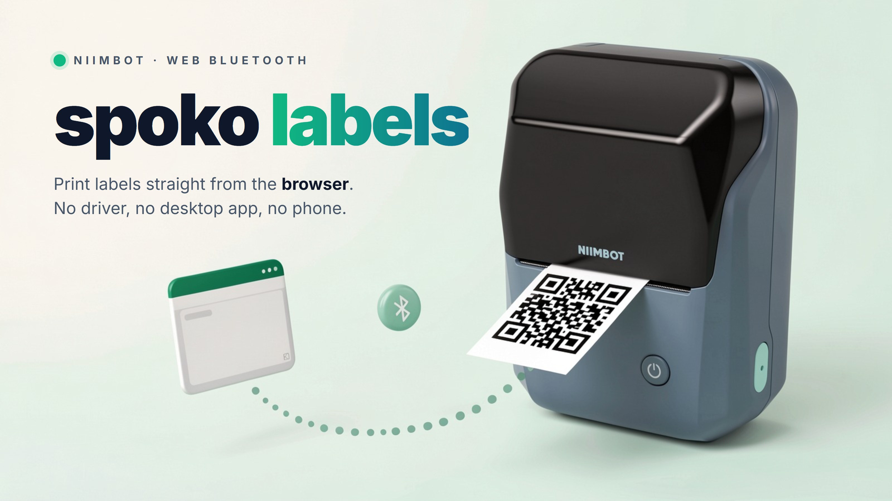

<picture>
  <source media="(prefers-color-scheme: dark)" srcset="art/cover-dark.jpg">
  
</picture>

# spoko-labels

Print labels on NIIMBOT label printers straight from the browser — no driver, no desktop app, no phone. Over Web Bluetooth.

> Work in progress. The printer layer works today; templates, import, the embeddable dialog and the web app are being built.

## What works today

- **[`@spokospace/labels-core`](packages/core/README.md)**: connect to a NIIMBOT B1 from a click, read its battery and firmware, and print any black-and-white image with a chosen density, number of copies and calibration offset; a print can be aborted. Checked on a real B1 with 50×30 mm labels.
- **A hardware-check page** for trying it on your own printer: `pnpm --filter @spokospace/labels-core example`, then open `http://localhost:8080/examples/hardware-check/` in Chrome or Edge (see the [package README](packages/core/README.md#hardware-check-page)).

Not published to npm yet.

## Tested on the NIIMBOT B1

Development and testing happen mainly on a **NIIMBOT B1** (203 dpi, 384-dot print head, 50×30 mm labels). That is the printer every change is checked against, so it is the one to expect to work. Other NIIMBOT models speak a similar protocol, but they are not tested yet; reports and pull requests are welcome.

## What it will do

- **Print from the browser** over Web Bluetooth (Chrome/Edge on desktop and Android).
- **Render label templates** — text, QR codes, lines — with fields bound to your data.
- **Import templates you designed in the NIIMBOT desktop app**, so existing designs keep working.
- **Load data** from an xlsx file or any JSON API, search it, pick rows, print.
- **Embed a "Print label" dialog** in your own web app.

## Packages

| Package | Purpose |
|---|---|
| [`@spokospace/labels-core`](packages/core/README.md) | printer protocol and Web Bluetooth connection (available) |
| `@spokospace/labels-render` | label template engine (planned) |
| `@spokospace/labels-niimbot` | import templates from the NIIMBOT desktop app (planned) |
| `@spokospace/labels-embed` | drop-in "Print label" dialog for other apps (planned) |
| `apps/web` | the public web app (planned) |

## Development

Requires Node 22+ and pnpm.

```bash
pnpm install
pnpm typecheck && pnpm lint && pnpm test && pnpm build
```

Contributions follow [SDLC.md](SDLC.md); AI agents start with [AGENTS.md](AGENTS.md).

## Acknowledgements

The agent skills in `.claude/skills/` (the `om-*` spec, implementation, review and merge pipeline described in [SDLC.md](SDLC.md)) come from [open-mercato/skills](https://github.com/open-mercato/skills/). The exact versions in use are pinned in [skills-lock.json](skills-lock.json).

## Not affiliated

This is an independent project. It is not affiliated with or endorsed by NIIMBOT.

## License

[MIT](LICENSE)
