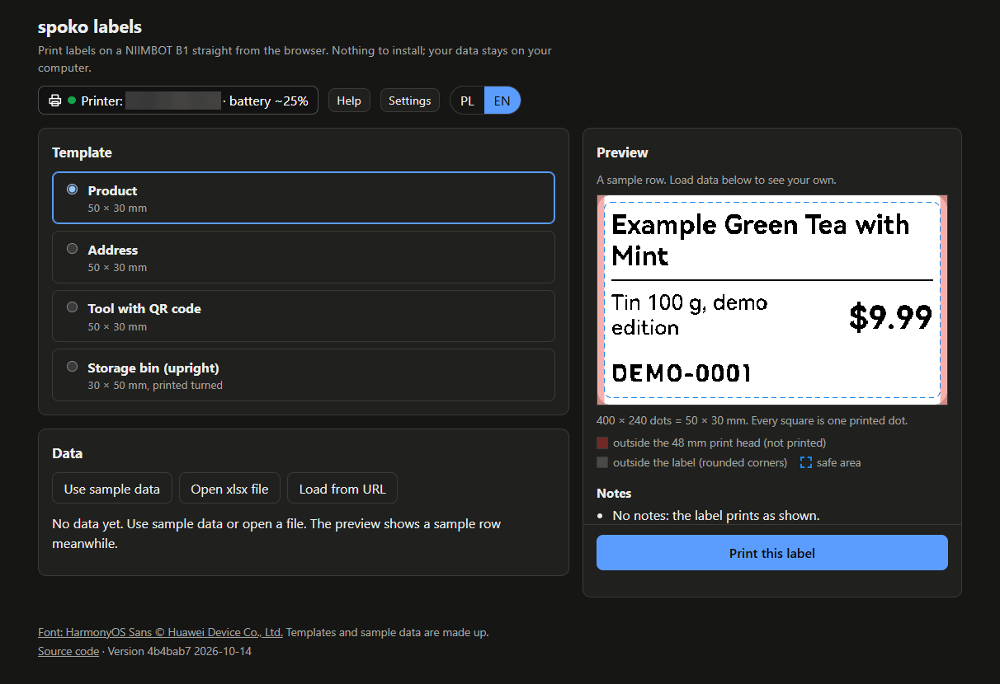

# @spokospace/labels-web

The public web app: pick a template, load data from an xlsx file or a JSON API, see exactly what will print, and print it on a NIIMBOT B1 from the browser. Built with Vite and plain TypeScript, no UI framework. Private: it exports no code.

Live: **[spoko-labels.pages.dev](https://spoko-labels.pages.dev)**. It is deployed by hand, so it can be behind `main`; the footer shows the commit it was built from.



> **Status: Phases 1 to 3 of `.ai/specs/2026-10-14-labels-web-app.md`.** The app shell, Polish and English, the built-in templates, the preview, the data (sample rows, xlsx files, a JSON API, column mapping, search and row selection) and printing (the printer chip, the print dialog, the calibration settings and the printer help) are in. The Phase 3 hardware check on a B1 is the maintainer's. The NIIMBOT import and deep links follow in later phases.

## Running it

```bash
pnpm install
pnpm --filter @spokospace/labels-web dev       # http://localhost:5173
pnpm --filter @spokospace/labels-web build     # writes apps/web/dist/
pnpm --filter @spokospace/labels-web preview   # serves dist/
```

Nothing has to be built first: `vite.config.ts` resolves the four workspace packages to their sources (`packages/<name>/src/index.ts`), and Vite copies the fonts they reference as hashed assets.

## What is where

- `index.html`, `src/main.ts`: the page and its wiring.
- `src/i18n/`: `en.ts` and `pl.ts` (the same keys, checked by type), `t()`, the language switch, and the wording of every code the packages report (`ErrorCode`, the embed outcome codes, `IssueCode`, the NIIMBOT import codes), typed so that a new code fails `pnpm typecheck` until it is worded.
- `src/templates/builtin.ts`: the built-in templates and their sample rows. Everything in them is made up. Their ids (`product`, `address`, `tool`, `upright`) will be part of the deep-link contract.
- `src/preview.ts`, `src/overlay.ts`: the preview at exact dots, with the label shape, the safe area and the strips outside the 48 mm print head, the worded render warnings and a text alternative for the canvas.
- `src/data/`: loading and shaping data, without the DOM.
  - `xlsx.ts`: the first sheet of an xlsx file, through `read-excel-file` (loaded on demand). The first row names the columns (an empty name becomes "Column C", a repeated one "Name (2)"); cells become text (numbers with `String(n)`, dates as `YYYY-MM-DD` in UTC). Files over 10 MB are not read; at most 10,000 rows and 500 columns are kept, each with a notice; empty cells are not stored. The archive is inflated on the page and handed over uncompressed, because read-excel-file's unzipper would otherwise start a blob: Web Worker for large sheets, which the CSP blocks. The bytes actually inflated are counted (not the sizes the zip headers claim), and a file that unpacks to over 100 MB is refused (it is held about three times over while reading, which a phone has to fit).
  - `api.ts`: a JSON API: `GET`, `credentials: "omit"`, no custom headers, HTTPS only (`http://localhost` and `http://127.0.0.1` in `vite dev` only), a 15 s timeout, Cancel, and a 10 MB cap counted on the streamed body. The rows are an array at the top level or at a dot path (`data.items`); the columns are the union of the keys; nested values become JSON text. Only the URL without its query, fragment and credentials is remembered, with the path.
  - `mapping.ts`: the column pickers' logic. Fields bound by name get row keys of that name; fields bound by position (NIIMBOT imports) get a row key of their own per position (`"\u0000pos-0"`, …), listed in `columns`, so they never collide with a bind name or a source column; a field with no pick has no row key, so render reports `missing-column` and it prints empty.
  - `search.ts`: search over every column, ignoring case and diacritics.
  - `table.ts`: the shared row shape. Rows are built with `Object.fromEntries` and read with `Object.hasOwn`, so a column named `__proto__` is an ordinary column.
- `src/data-panel.ts`: the Data panel: the source buttons, the URL form, the pickers, the search and the row table (checkboxes, "select all shown", the count and the 200-label limit, arrows and space on the keyboard, a list on phones), and the rows Print prints. The data stays in memory; nothing loaded is stored.
- `src/browser.ts`: the banners for a browser without Web Bluetooth (with Brave's flag) and for a page that is not HTTPS, each with a link to the help.
- `src/printing.ts`: printing through the public `labels-embed` API. `main.ts` calls `defineElements()` once, puts `<spoko-printer-status>` in the header (a language switch sets its `lang` attribute, which the chip observes) and calls `printerSession.tryReconnect()` on load. The Print button says "Print selected (N)", or prints the previewed row (the sample row before any data is loaded) when nothing is selected; it is disabled above 200 selected rows and without Web Bluetooth. It calls `printLabels()` with the mapped rows, the template, its column order (templates bound by position) and the calibration; copies and density are set in embed's dialog. The chip and the dialog live in embed's shadow DOM, so the app shows what they report in a banner of its own, with a link to the help (a browser without Web Bluetooth gets `browser.ts`'s banner instead): a session `statechange` to `disconnected` with an error (not `chooser-cancelled`) or to `busy-elsewhere` (linked to the other-tab help), and a print whose outcome has `error.code`. On a desktop the preview column is sticky with the Print button at its bottom; on a phone the Print button is fixed to the bottom of the screen.
- `src/calibration.ts`, `src/settings-panel.ts`: the printer settings: the calibration (`offsetMm`) x from −8 to 8 mm and y from 0 to 10 mm, from core's `OFFSET_LIMITS_MM`, the ranges `Printer.print()` accepts; "Reset to default" (core's `B1.offsetMm`, 0 / 0.5 mm); shown with the language's decimal separator; stored in `localStorage`. A stored value that is not two numbers within the limits gives the default; an invalid entry is marked and ignored.
- `src/help.ts`: the printer help: browser support, Brave (`brave://flags/#brave-web-bluetooth-api`, and the optional `#enable-web-bluetooth-new-permissions-backend` that Chrome and Edge have too; checked on Brave 1.97), the phone app and the connection, the printer in use in another tab, calibration and density. Every `labels-core` error code and embed outcome code maps to a section or to none (one typed `Record`, so a new code fails `pnpm typecheck`).
- `src/dialog.ts`, `src/dom.ts`: the panels' modal `<dialog>`, and the small element helper the panels share.
- `public/_headers`: the Cloudflare Pages headers (Content Security Policy, `Permissions-Policy: bluetooth=(self)` and others).
- `scripts/deploy.mjs`: the deploy, below.

Everything the user loads or a template holds is shown as text (`textContent`, built nodes), never as HTML.

## Fonts

Labels are drawn with HarmonyOS Sans (© Huawei Device Co., Ltd., HarmonyOS Sans Fonts License Agreement) and SIL OFL fonts. The footer shows "Font: HarmonyOS Sans © Huawei Device Co., Ltd.", as the agreement asks. The build copies `LICENSE-HarmonyOS-Sans.txt` and every `OFL-*.txt` unchanged into `dist/licenses/` (a test checks it); the footer's font notice links to the HarmonyOS Sans license. They are not in `dist/assets/`, which is cached for a year as immutable and suits hashed file names only.

## Deploying (Cloudflare Pages, by hand)

Nothing deploys from CI: GitHub Actions do not run on this account, so merging a pull request does not change the live site. The maintainer deploys from their own machine.

One time: log in to Cloudflare with the same pinned wrangler the script uses.

```bash
pnpm dlx wrangler@4.151.0 login
```

The Pages project `spoko-labels` already exists. To create it again (a new account, or a fork; a fork with another project name also changes `PROJECT` in `scripts/deploy.mjs`), pass `--force` once: wrangler 4.151 otherwise tries to create a Workers project and fails.

```bash
pnpm dlx wrangler@4.151.0 pages project create spoko-labels --production-branch main --force
```

Each deploy, from an up-to-date checkout of `main`:

```bash
git switch main && git pull
pnpm install && pnpm typecheck && pnpm lint && pnpm test && pnpm build
pnpm --filter @spokospace/labels-web run deploy:pages
```

The script is `deploy:pages`, not `deploy`: `pnpm --filter … deploy` would run pnpm's own `deploy` command. It runs `pnpm dlx wrangler@4.151.0 pages deploy dist --project-name spoko-labels --branch main`, and refuses, with a message, when:
- the working tree has uncommitted or untracked files;
- `HEAD` is not `origin/main` (after `git fetch origin main`);
- `dist/` is missing, was built from another commit, or was built from a tree with uncommitted changes (its commit is marked `-dirty`).

The custom domain is set in the Cloudflare dashboard, not here.

**Checking a deploy.** A deploy is done only when the live page shows the merged commit:
1. Open the production URL. The footer shows the version: the short commit and its date.
2. Compare it with `git rev-parse --short origin/main`.
3. `pnpm dlx wrangler@4.151.0 pages deployment list --project-name spoko-labels` lists the latest deployment.

If the footer shows an older commit, the deploy did not happen: run it again.
